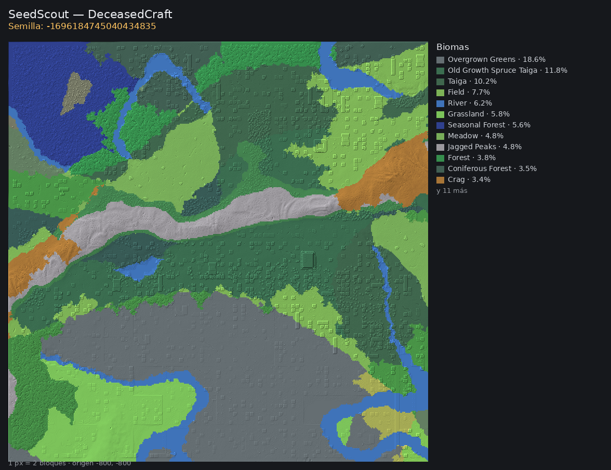
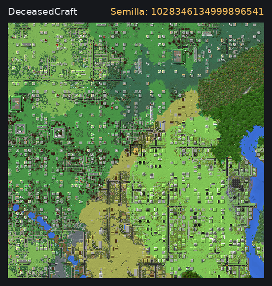

<div align="center">

# SeedScout

**Explorador de semillas para modpacks pesados de Minecraft, con el mapa real de cada mundo.**


</div>

---

## Qué es

Herramientas como Chunkbase o Amidst reimplementan la generación de Minecraft *vanilla*. En un
modpack que reescribe los biomas y las estructuras (BiomesOPlenty, TerraBlender, Lost Cities),
el mapa que dan es el de otro juego. SeedScout no simula la generación: **arranca el servidor
real del modpack**, pregenera un radio con Chunky y dibuja el mapa a partir de los archivos del
mundo. Lo que se ve es lo que se va a jugar.

<p align="center">
  
  
</p>

<p align="center"><sub>Imágenes para compartir que genera SeedScout, de dos semillas de prueba en DeceasedCraft. Se arman con <code>tools/capturas/capturas.py</code>.</sub></p>

## Funciones principales

- Mapa pintado como los mapeadores del juego: color del bloque, tinte de bioma, agua por
  profundidad y sombreado de pendiente.
- Biomas con su porcentaje, ciudades detectadas y el chunk del spawn recuadrado.
- Lectura del bioma, el bloque, la altura y las coordenadas bajo el cursor.
- Semillas guardadas con notas, y el servidor vivo entre generaciones para ampliar el radio.

## Tecnologías

| Capa | Tecnología |
|---|---|
| Núcleo | Python: lectura de regiones `.mca` y render por bloque |
| Interfaz | Flask, en el navegador |
| Imagen | Pillow y NumPy |
| Generación | el servidor Forge del propio modpack, con Chunky |

## Puesta en marcha

Necesita un servidor del modpack instalado y el `.jar` del cliente de Minecraft para las
texturas. Las rutas se configuran en `~/.config/seedscout/config.json`:

```bash
python3 -m seedscout config --write   # crea la configuración para editarla
python3 -m seedscout web              # interfaz en http://127.0.0.1:5055
python3 -m seedscout gen 12345 --radius 512 --save
```

## Documentación

- [`docs/guia.md`](docs/guia.md): uso completo, tiempos y funcionamiento.
- [`docs/`](docs/): decisiones de diseño (ADR).

## Licencia

Código bajo **GPL-3.0-or-later** ([`LICENSE`](LICENSE)). Los componentes de terceros y sus licencias
están en [`NOTICE`](NOTICE). El nombre y la identidad visual no forman parte de la licencia: ver
[`TRADEMARKS.md`](TRADEMARKS.md). Para aportar, [`CONTRIBUTING.md`](CONTRIBUTING.md).

## Apoyo

Este proyecto forma parte del trabajo de **NoctiVulp**: herramientas para Linux y Android,
publicadas como software libre. Las compilaciones oficiales y las novedades salen en Patreon.

<p align="center">
  <a href="https://www.patreon.com/cw/NoctiVulp"></a>
</p>

---

<p align="center"><sub>© 2026 NoctiVulp · <b>Powered by AI</b> — desarrollado con la asistencia de Claude, de Anthropic.</sub></p>
